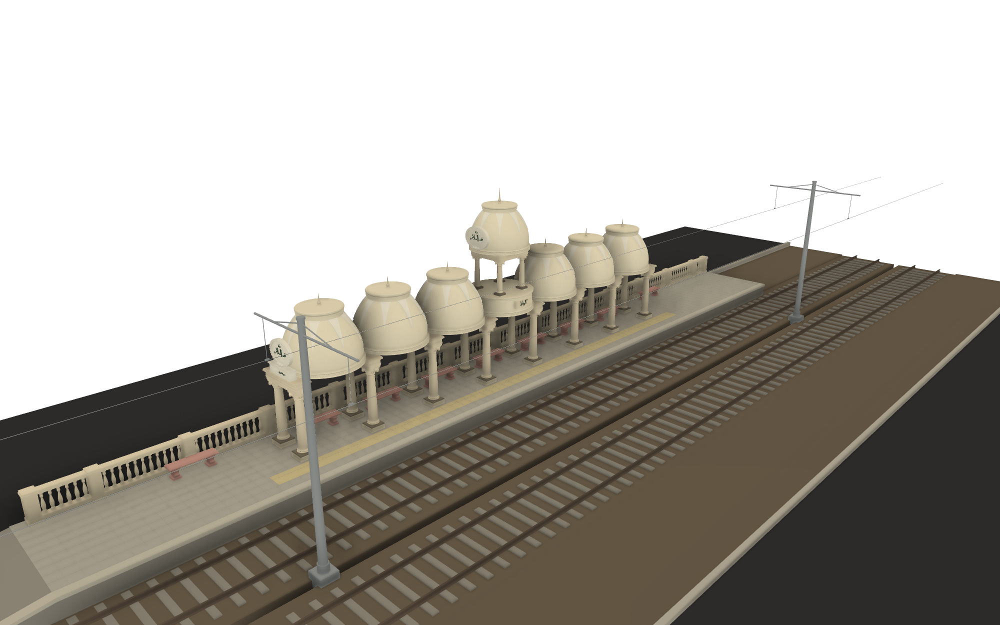
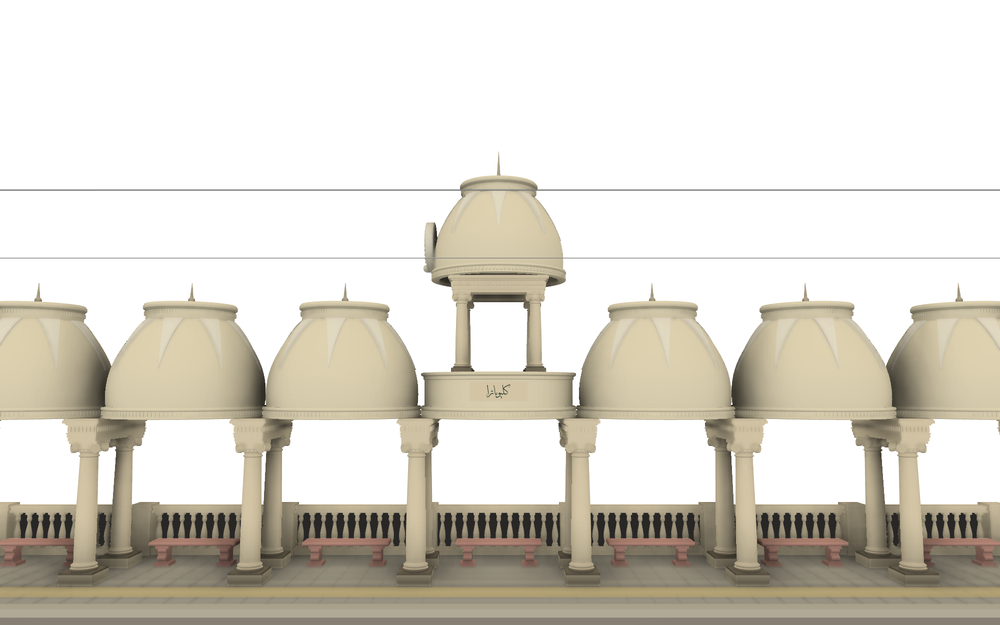

# Alexandria Raml tram — Cleopatra Hammamat station

A detailed, parametric 1:1 CAD model of the **Cleopatra Hammamat** (Cleopatra El Kobra) tram stop on the
Alexandria Raml line: two point-symmetric colonnades of Ionic columns carrying cast-concrete bell domes, staggered
across the Sidi Gaber Street level crossing, with the two-tier domed pavilion, the sponsor's cartouche, platforms,
balustrades, benches, double track and overhead line. Modelled as it stood, intact, around 2024.

## The station
- **Where:** Sidi Gaber Street at the level crossing with Medhat Seif El Yazal Khalifa Street, Sidi Gaber /
  Cleopatra district, Alexandria — about **31.22130 N, 29.93789 E**
  ([OpenStreetMap](https://www.openstreetmap.org/?mlat=31.22130&mlon=29.93789#map=19/31.22130/29.93789)).
  Raml line, **northern (Bacos) loop** of the Sidi Gaber fork, served by route 1: Sporting El Kobra → Cleopatra
  El Soghra → **Cleopatra Hammamat** → Sidi Gaber El Sheikh → Mustafa Kamel.
- **What:** one colonnade per direction, each on its own platform beyond the crossing (far-side stops): the
  **SW colonnade** on the south-east side of the street and its **twin NE of the crossing** on the north-west side.
  Each is a row of 8 transverse column frames carrying 7 hollow dome canopies; the 4th canopy is replaced by a
  drum carrying a second tier of colonnettes and an upper dome. The crossing-end canopy carries an oval laurel
  cartouche, **"شركة / قصر السلام / …"** (Qasr El Salam company), over the credit line **"تصميم المعماري م/ …"**; the
  drum carries the name **"كليوباترا"**.
- **History:** a late-20th-century sponsored shelter in classical dress (cast-concrete Ionic order, ogee "bell"
  domes), not one of the Alexandria & Ramleh Railway's original stations and not on the heritage register.
  Architect and date unknown (the architect's name on the frieze is illegible in every available frame).
- **Status:** the 2022 Raml modernisation ESIA removes the northern Sidi Gaber loop and its three stations. Service
  on the branch ended by early 2026 (the whole line closed in phases, February–April 2026); the rails were lifted
  by September 2026 and **demolition began in September 2026** — one colonnade was rubble by late September, the other still stood in
  early October. This model records both colonnades **intact, as in 2024**.

## What's modelled
| Area | Content |
|---|---|
| Columns (32) | Scamozzi-type Ionic: square plinth, Attic base (torus–scotia–torus), shaft with entasis, astragal, egg-and-dart echinus, four diagonal volutes with raised spirals and eyes, concave-sided abacus |
| Frames (16) | Two columns across the platform under a transverse entablature: two-fascia architrave, frieze with a row of dentil blocks, corona and cyma, wrapped round all four faces |
| Canopies (12 + 2 upper) | Hollow cast RC shells (80 mm) spanning between neighbouring frames: moulded lip band with bead, dentils and ovolo; pot/bell dome; eight raised lotus lappets hanging from the dentilled crown ring; finial spike; concave soffit |
| Two-tier unit (×2) | Drum with dentilled cornice and flat deck, framed "كليوباترا" plaque, four Ionic colonnettes, square upper entablature, upper dome with its own crown, finial and cartouche |
| Cartouche (×2 per side) | Attic block with framed credit line, oval tablet with laurel wreath and three roses, raised Arabic lettering (CoreText → SVG outlines) |
| Platforms (×2) | 4.2 m platforms, 0.5 m above rail, end ramp, coping, 40 cm paving with joints, tactile band |
| Balustrades | Piers with caps at frame pitch, plinth rail, handrail, 142 turned vase balusters per side (instanced) |
| Benches | Pink terrazzo benches on waisted pedestals with scrolls, one per bay plus one at each platform end |
| Track and street | Double track, 1435 mm, flat-bottom rails on concrete sleepers in an earth/ballast bed; paved level crossing with flangeways; carriageways, kerbs and verges |
| Overhead line | Tapered centre poles with twin bracket arms, stays, droppers, contact wires at 5.6 m |
| Finish | Slightly weathered white/cream render, stained tan soffits, grime on column bases, green-painted lettering |

The repeating **Canopy Module** (one frame + one canopy) is a single component instanced 6 times per side; the
**Tall Module** once; the whole **Station Side** is instanced twice (the NE side as modelled and the SW side
rotated 180° about the crossing centre).

## Key dimensions
No drawings survive in public. Everything except the gauge is photogrammetry from the owner's night photos (March
2026), YouTube daylight frames (2022–2026) and Esri imagery. Full sheet with methods:
[`references/notes/dimensions.md`](references/notes/dimensions.md).

| Dimension | Model | Confidence |
|---|---|---|
| Canopies / frames / columns per colonnade | 7 / 8 / 16 (+ 4 colonnettes) | MEDIUM |
| Two-tier unit | 4th canopy from the crossing end | MEDIUM |
| Frame pitch = canopy lip diameter | 2.85 m (colonnade 19.95 m) | LOW-MED |
| Column, plinth bottom → abacus top / lower diameter | 2.40 m / 0.34 m (H/D 7.1) | LOW-MED (ratio MEDIUM) |
| Column spacing across a frame | 1.30 m | LOW-MED |
| Entablature | 0.38 m | LOW-MED |
| Dome rise (lip top → crown top) / crown ring | 1.85 m / Ø 1.50 m | LOW |
| Low canopy, platform → crown top | 4.83 m (+ 0.42 m finial) | LOW |
| Two-tier unit, platform → crown top | 7.18 m (+ 0.65 m finial) | LOW |
| Platform height above rail / width | 0.50 m / 4.20 m | MED-LOW / LOW |
| Track gauge / track centres | 1435 mm / 3.8 m | HIGH / LOW |
| Crossing centre → first frame | 17 m | LOW |
| RC shell thickness | 80 mm | MED-LOW |

Every dimension is a Fusion user parameter whose comment records its source and confidence.

## Files
| Fusion design (project Eshera-Personal, folder *Alexandria Tram Station - Cleopatra Hammamat*) | Export in `models/` |
|---|---|
| **Cleopatra Hammamat Station** — both sides, track, crossing, OCS | `Cleopatra Hammamat Station.f3d`, `Cleopatra Hammamat Station.step` |

## Rebuilding from the scripts
The whole model is generated by the Fusion API scripts in [`fusion/scripts/`](fusion/scripts/), run through a
small exec loader that passes `__file__`: create an empty design, run `params.py`, then the build scripts in order.
Loader, component structure and build order: [`fusion/README.md`](fusion/README.md). Change a parameter (e.g.
`pitch`, `col_h`, `dome_rise`, `n_can`) and re-run the scripts that use it; every instance follows.

## Opening the exports
- **`.f3d`** — Fusion archive with the parameters, components and appearances. *File → Open → Open from my
  computer*. The calibrated satellite underlay used for the plan check is **not** included (third-party imagery);
  `fusion/scripts/canvases.py` recreates it from a local copy.
- **`.step`** — AP214 assembly with colours, for FreeCAD, SolidWorks, Onshape, Rhino, etc.

## 3D printing
- The model is a **1:1 master**; scale on export (1:87 → a 19.95 m colonnade is 229 mm; 1:150 → 133 mm).
- All parts are closed solids with real thicknesses (80 mm shells, 12 mm contact wire). Below about 1:50 the dentils
  (40 mm), lappets (20 mm proud), balusters and lettering (15–20 mm relief) fall under printable size: thicken,
  simplify or drop them in a print variant. The domes print best as separate parts, upside down (open soffit up).
- Overlapping solids (instances meeting at the lips, paving over the platform body) should be combined or
  separated per print plan; the track, street and OCS are separate components that can be left out.

## Known gaps
- **Absolute scale** rests on the column height (±15 %); plan dimensions on the satellite lengths (±1 m per
  colonnade). A tape on any surviving column, plinth or platform would fix both.
- **Dome profile** is the least certain shape (side-on daylight silhouettes only from moving trams).
- The **third cartouche line** and the **architect's name** are illegible and left blank.
- Satellite puts the two colonnade axes ≈ 14 ± 2 m apart; the model has 11.3 m (track centres and platform offsets
  were kept at plausible values). The photographer's compass heading (206–211°) disagrees with the satellite track
  azimuth (56°/236°); the satellite was used.
- The NE twin is modelled identical to the SW colonnade (same counts in both 2024 videos); small differences in
  benches, signs and lighting are not modelled. Platform-end details, the masonry kiosk opposite, lamp posts,
  signage and vegetation are not modelled.
- Weathering is colour only (no textures).

## Repository layout
| Path | Contents |
|---|---|
| `models/` | F3D + STEP exports |
| `fusion/` | Build scripts and loader docs |
| `tools/lettering/` | CoreText → SVG tool, generator script, generated SVGs |
| `docs/BUILD-LOG.md` | Decisions, measurements, Fusion API gotchas |
| `docs/renders/` | Viewport renders |
| `references/notes/` | Dimension sheet v1 |
| `references/SOURCES.md`, `references/manifests/` | Sources and image manifests (no images included) |

## Credits and sources
Owner's photos (Ibrahim Eshera, March 2026). Daylight frames from YouTube videos by Amr Veto, ahmed salah,
Tram El Raml, Am El Sayed El Masry, Hekayat Moug El Bahr, Yasser Hayrouh Fein and Shawarea Masr ma3 Mina (cited by
video ID, not redistributed). Esri World Imagery, OpenStreetMap, the Raml Tram ESIA (NAT / EcoConServ, EIB
register). Full list in [`references/SOURCES.md`](references/SOURCES.md).

## Related models
- [alexandria-tram-raml-221-223](https://github.com/imeshera/alexandria-tram-raml-221-223) — Raml single-deck set
- [alexandria-tram-raml-dd-224](https://github.com/imeshera/alexandria-tram-raml-dd-224) — Raml double-deck car
- [alexandria-tram-gt6-894](https://github.com/imeshera/alexandria-tram-gt6-894) — Duewag GT6
- [alexandria-tram-heritage-601](https://github.com/imeshera/alexandria-tram-heritage-601) — heritage car 601
- [alexandria-tram-city-1211-1212](https://github.com/imeshera/alexandria-tram-city-1211-1212) — Ganz city set
- [alexandria-lada-taxi](https://github.com/imeshera/alexandria-lada-taxi) — Alexandria Lada taxi
- [alexandria-tram-station-sporting-el-soghra](https://github.com/imeshera/alexandria-tram-station-sporting-el-soghra) — Sporting El Soghra station

## Licence
Code (`fusion/`, `tools/`): MIT, see [`LICENSE`](LICENSE). Models, documentation and renders: CC BY 4.0, see
[`LICENSE-models.md`](LICENSE-models.md). © 2026 Ibrahim Eshera.
